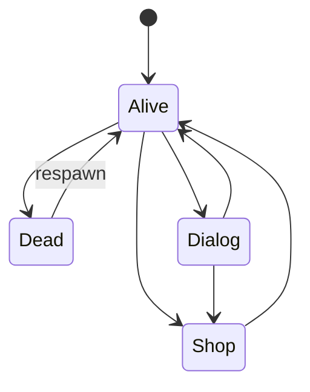
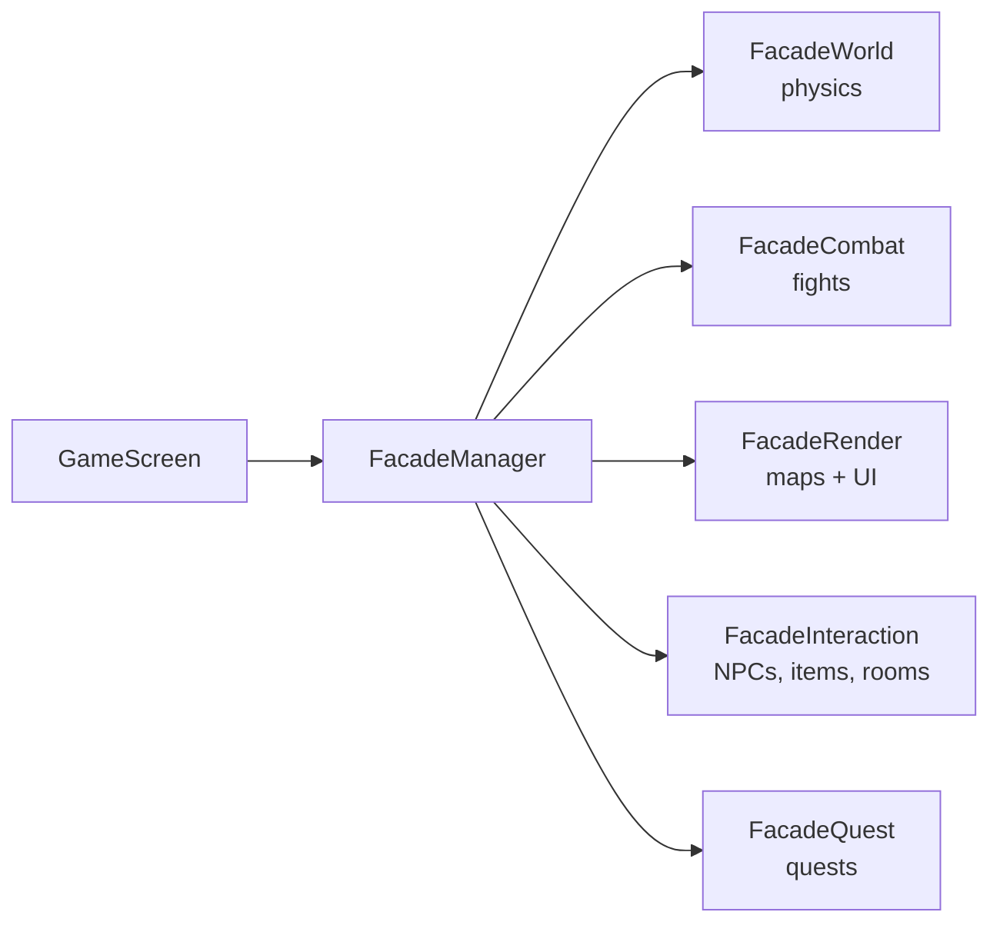

# Professional Programming : Design Patterns in a 2D Adventure Game

> A school project focused on **object-oriented programming and design patterns** (Factory, Observer, State, Strategy, Singleton, Facade), applied to a small 2D adventure game in Java with libGDX
> The goal was to **study the patterns**, not to ship a complet game, therefore, it is a playable prototype that gives each pattern a concrete, testable use.

---

## Table of Contents
- [Context](#-context)
- [The Prototype](#-the-prototype)
- [Controls](#-controls)
- [Design Patterns](#-design-patterns)
- [OOP Concepts](#oop-concepts)
- [Requirements Coverage](#-requirements-coverage)
- [Getting Started](#-getting-started)
- [Retrospective](#-retrospective)
- [Credits](#-credits)

---

## Context

This project was built during my **first year engineering school** course on object-oriented design. The guideline was an adventure game in Java that demonstrates:

- The five core **OOP concepts** : aggregation, cohesion, inheritance, encapsulation, polymorphism;
- Six **design patterns**: Factory, Observer, State, Strategy, Singleton, Facade.

Our original brief was to do it in a **text-base console game**. However, in order to go further, I choose to build a **2D graphical game with libGDX** instead. It made the project more demanding (physics, rendering, UI), but it gave the patterns real problems to solve: movement physics for Strategy, UI updates for Observer, gameplay modes for State, and a large set of subsystems behind a Facade.

## The Prototype
A side-view adventure across **10 connected rooms** built in Tiled;
- **Explore** a village, a forest and a cave, with Box2D physics (gravity, jumps, collisions).
- **Talk to NPCs** with branching dialogs written in **Ink**: Pierrot, the Guide, the Chief (who gives a quest) and a merchant, *Le Roublard*.
- **Pick up gold and potions**, manage an **inventory**, and **combine** two small potions into a large one.
- **Buy potions** from the merchant.
- **Fight two enemy types** in **turn-based combat**, triggered when the player touches an enemy:
    - *Le Furieux* (melee): advances and attacks at short range.
    - *Le Paria* (ranged): keeps its distance and attacks from afar.
    - Both switch to a **cautious behavior** (retreat) when their health drops to or below.
- **Complet the "Carnage" quest**: defeat every enemy in the cave.
- **Save and load** the game in *6 slots* (JSON files), from the pause menu.
- **Game over and respawn** when the player dies.

Range matters in combat: each attack (*Fire*, *Water*, enemy attacks) has a range, and an attack misses if the target is too far. Enemies move forward or back each turn to get in range.

---

## Controls

| Action | Input |
|--------|-------|
| Move | `Q` / `D` or `←` / `→` |
| Run | `Shift` + move |
| Jump | `Space` |
| Talk to an NPC / open the shop | `E` (when nearby) |
| Inventory | `I` |
| Pause menu (save, main menu) | `Esc` |
| Combat actions, dialog choices, menus | Mouse |

---

## Design Patterns

### Factory : creating game objects

`Factory/`
 
| Factory | Creates |
|---------|---------|
| `RoomFactory` | `CombatRoom`, `PacificRoom` |
| `EnemyFactory` | `CloseCombatEnemy`, `FarCombatEnemy` |
| `PNJFactory` | `BasicPNJ`, `QuestPNJ`, `MerchandPNJ` |
| `ItemFactory` | `Gold`, `Potion`, large `Potion` |
| `QuestFactory` | `SlayAllEnemiesQuest`, `GoToQuest` |

The calling code only works with the abstract types (`Room`, `Enemy`, `PNJ`, `Pickable`, `Quest`). The factories are also **reused when loading a save**: the save file stores type names, and the factories rebuild the objects from them.

### Observer: game events
`GameEvent/`

A central **event bus** (`GameEventBus`) publishes typed events (`GameEvent` enum : `PLAYER_HIT`, `ENEMY_DIED`, `ITEM_PICKED`, `COMBAT_STARTED`, `DIALOG_FINISHED`, `SHOP_OPENED`, and more) to every subscribed `GameEventObserver`.

- The combat logic publishes `ENEMY_HIT` and the UI displays the notification, whitout either knowing about the other.
- `QuestPNJ` **subscribes only while its dialog is open**: when it receives `DIALOG_FINISHED`, it gives its quest to the player and **unsubscribes itself**.
- The bus iterates over a **copy** of the observer list, so an observer can safely unsubscribe while an event is being dispatched.

### State: gameplay modes
`State/`

The player (`Stateful`) is always in one of four states: `AliveState`, `DeathState`, `DialogState`, `ShopState`. **Each state decides which transitions are allowed**. An invalid transition, such as opening a dialog while dead, throws an exception instead of silently corrupting the game.

### Strategy: movement, combat and enemy AI
`Strategy/`
 
| Family | Strategies | Used for |
|--------|------------|----------|
| **Movement** | `IdleStrategy`, `WalkStrategy`, `RunStrategy`, `JumpStrategy`, `FallStrategy` | Player physics |
| **Combat** | `TurnBasedCombat` (implements `CombatStrategy`) | Combat rules |
| **Enemy AI** | `PrudentStrategy` (implements `EnemyCombatStrategy`) | Enemy behavior at low health |

- The movement strategies share an **abstract base class** (`AbstractMovementStrategy`) that applies horizontal speed. Each strategy only defines it speed and its vertical behavior: the jump impulse, or stronger gravity when falling for a snappier jump.
- Each strategy decides which **transitions** are allowed (`canTransitionTo`). For example, a jump cannot restart in mid-air.
- Enemies **swap strategy at runtime**: below 2HP, they switch to `PrudentStrategy` and retreat.
- `TurnBasedCombat` is a small **turn state machine** (`PLAYER_TURN -> ENEMY_TURN -> ...`) with a delay between turns, so the player can follow what happens.

### Singleton: shared managers
`Managers/`, `Save/`, `GameEvent/`

`RessourceManager` (Box2D world, player, rooms), `QuestManager`, `DialogManager`, `SaveManager` and `GameEventBus` each have a single instance with lazy initialization. `RessourceManager` and `QuestManager` also have a `reset()` method, so that starting a new game or loading a save begins from a clean state.

### Facade: one entry point for the game loop

`Facade/`
 

`GameScreen` only calls `facadeManager.update()`. `FacadeManager` coordinates five sub-facades, one per subsystem, and also build and applies save data (`buildSaveData()` / `applySaveData()`), so the rest of the code never needs to know how a save is put together.

---
## OOP Concepts

| Concept | Implementation |
|---------|----------------|
|**Aggregation** | A `Room` containes items, NPCs and enemies; the `Player` has an `Inventory`; `MerchandPNJ` holds a stock of items |
|**Inheritance** | `BasicObject -> PhysicsObject -> Player / Enemy -> CloseCombatEnemy / FarCombatEnemy`; `PNJ -> BasicPNJ / QuestPNJ / MerchandPNJ`; `Room -> CombatRoom / PacificRoom`; `Quest -> SlayAllEnemiesQuest / GoToQuest` |
|**Polymorphism**| `Enemy.decideTurn()` differs for melee and ranged enemies; `PNJ.interact()` opens a dialog, gives a quest or opens the shop; `Pickable.onPickup()` adds gold or an item; `Quest.checkCompletion()` differs between quest types |
| **Encapsulation** | Private fields with getters and setters, validation in setters (`Attack` rejects negative damage or range), `protected` accessors where only subclasses need access |
| **Cohesion** | One responsibility per class: `RoomPopulationHandler` places NPCs and enemies, `RoomItemsHandler` places items, `SaveManager` only reads and writes files, `Dialog` wraps the Ink story |
| **Interfaces** | `Pickable`, `Item`, `Movable`, `Stateful`, `GameEventObserver`, `CombatStrategy`, `MovementStrategy` |

---
## Requirements Coverage

| Requirement | Status | Notes |
|-------------|--------|-------|
| 10+ connected rooms | ✅ | 10 Tiled rooms linked left, right and down |
| Items to pick up, use and combine | ✅ | Gold, potions (used in combat), 2 small potions → 1 large |
| NPCs with dialogs | ✅ | 4 NPCs, branching Ink dialogs |
| Combat with 2+ enemy types | ✅ | Melee and ranged, turn-based |
| Inventory | ✅ | Inventory screen with gold and potions |
| Save and load | ✅ | 6 JSON slots: position, health, room, inventory, quests, defeated enemies, merchant stock |
| Victory condition | ⚠️ | The "Carnage" quest can be completed, but there is no end screen |
| Console interface | ➖ | Replaced on purpose by a libGDX graphical interface |
| Factory, Observer, State, Strategy, Singleton, Facade | ✅ | See [Design Patterns](#-design-patterns) |

---

## Getting Started

### Requirements
- **JDK 21+**
- No other installation: the **Gradle wrapper** downloads Gradle and libGDX automatically

### Run the game
````bash
git clone https://github.com/Drc-NoxuX/ProgPro.git
cd ProgPro
./gradlew lwjgl3:run        # macOS / Linux
gradlew.bat lwjgl3:run      # Windows
````
You can also open the project in **IntelliJ IDEA** (*Open* -> select the folder) and run the `lwjgl3:run` Gradle task.

### Build a runnable JAR

```bash
./gradlew lwjgl3:jar
```
The JAR is created in `lwjgl3/build/libs/`.

### Project structure
```
ProgPro/
├── core/src/main/java/com/ProgPro/
│   ├── Facade/        ← Facade pattern: FacadeManager + 5 sub-facades
│   ├── Factory/       ← Factory pattern + game objects (rooms, enemies, NPCs, items, quests)
│   ├── GameEvent/     ← Observer pattern: event bus
│   ├── State/         ← State pattern: player states
│   ├── Strategy/      ← Strategy pattern: movement, combat, enemy AI
│   ├── Managers/      ← Singletons: resources, quests, dialogs, input
│   ├── Save/          ← Save system (JSON)
│   ├── Screen/        ← Main menu and game screens
│   └── UI/            ← scene2d UI: combat, dialogs, inventory, shop, quests, pause
├── lwjgl3/            ← Desktop launcher
└── assets/            ← Tiled rooms, Ink dialogs, UI skin, animations
```

---

## Retrospective

This is a resume of what I learned and what I would have changed with more time:

- **States and booleans sometimes overlap.** The player has State objects, but also flags like `isInDialog` or `isInShop` that the rest of the code reads. The State pattern would be more useful is the behavior lived in the states themselves, for example each state handling input its own way, and the flags were removed.
- **Singletons are convenient, but they hide dependencies.** They gave quick global access, but they make the code harder to test. I had to add `reset()` methods to restart a game cleanly. Passing dependencies through constructors would make them explicit.
- **Game content is hard-coded.** Rooms, NPCs, enemies and items are placed in Java code. Loading them from Tiled object layers or JSON files would let me change the level without recompiling.
- **Exceptions are too broad.** Many methods declare `thhrows Exception`. Specific exception types would make errors easier to understand and handle.
- **No automated tests.** Combat rules, inventory combining and quest completion are pure logic that could be unit tested.
- **A prototype, not a complete game.** Characters are drawn as placehorlder rectangles (the sprite animations are not connected yet), and the victory condition has no end screen.

---

## Credits

-**Development**: [Théodora Dragan Chopart](https://github.com/Drc-NoxuX)
- **Tilesets**: [Mossy Cavern](https://maaot.itch.io/mossy-cavern) and [Fungal Grotto](https://maaot.itch.io/fungal-grotto) by Maaot
- **Libraries**: [libGDX](https://libgdx.com) (with Box2D and scene2d), [blade-ink](https://github.com/bladecoder/blade-ink) to run [Ink](https://www.inklestudios.com/ink/) dialogs
- **Project template**: generated with [gdx-liftoff](https://github.com/libgdx/gdx-liftoff)